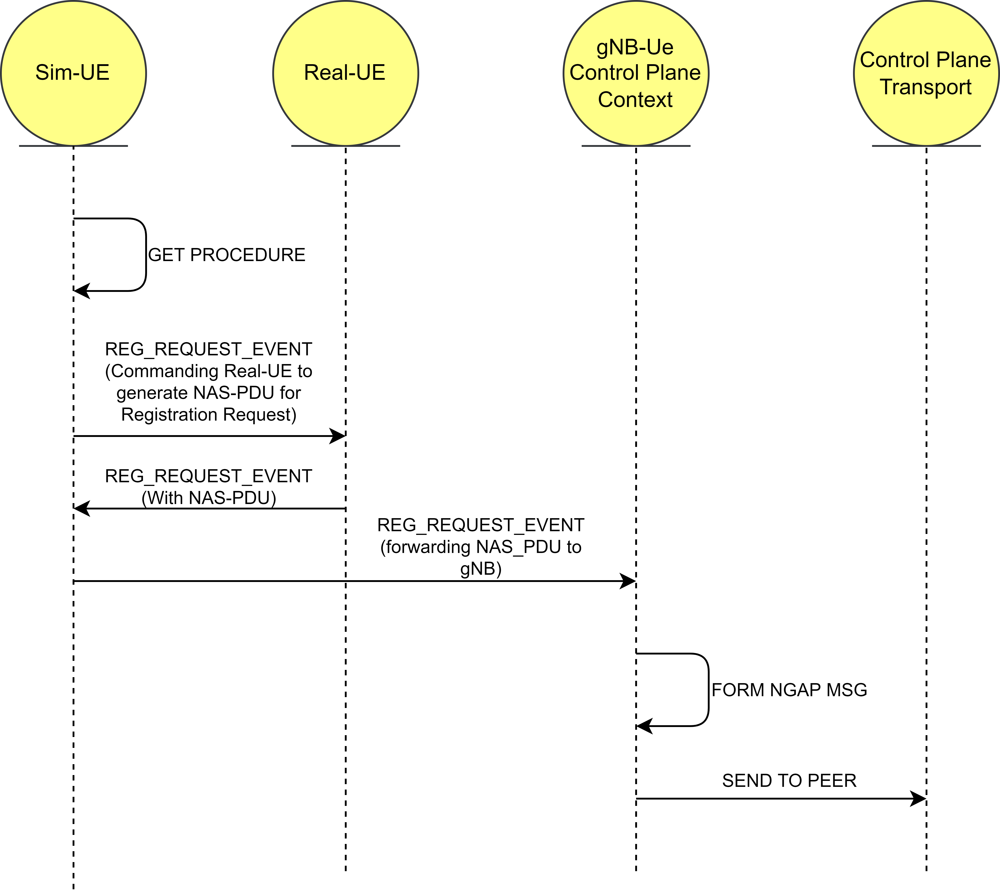
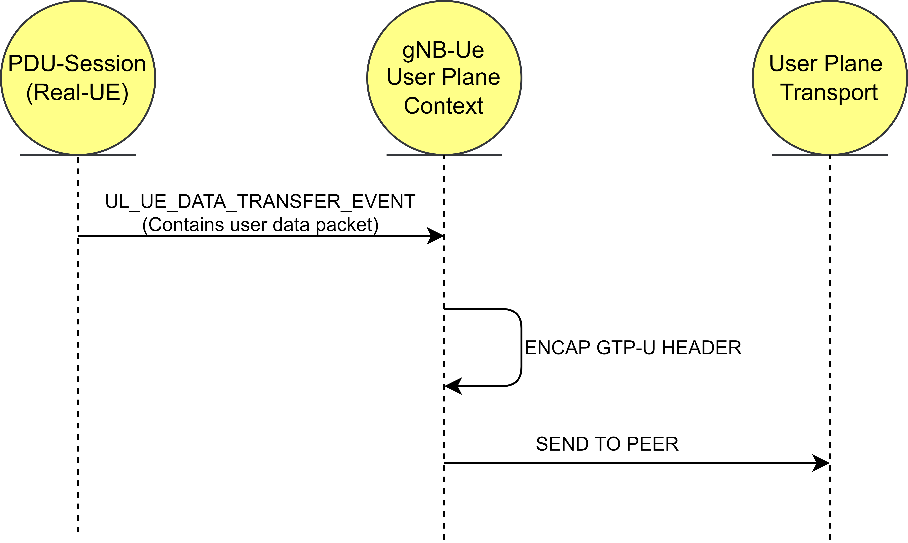

<!--
SPDX-FileCopyrightText: 2021 Open Networking Foundation <info@opennetworking.org>

SPDX-License-Identifier: Apache-2.0

-->

# gNBsim UE Originated messaging

## gNBsim UE Originated NAS message

## gNBsim UE Originated DATA message

